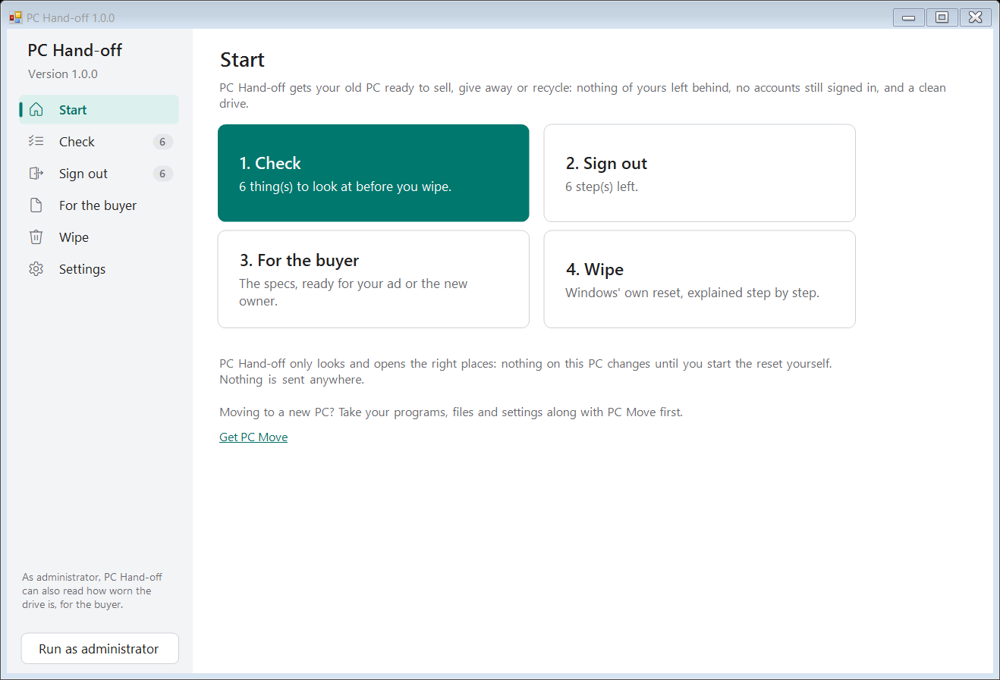
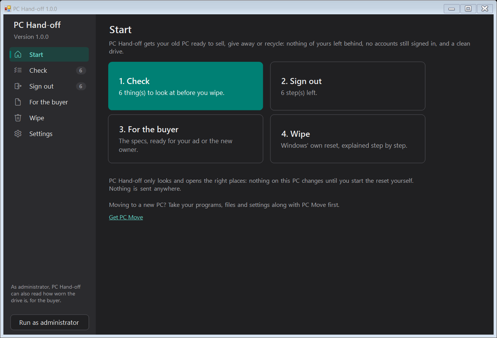
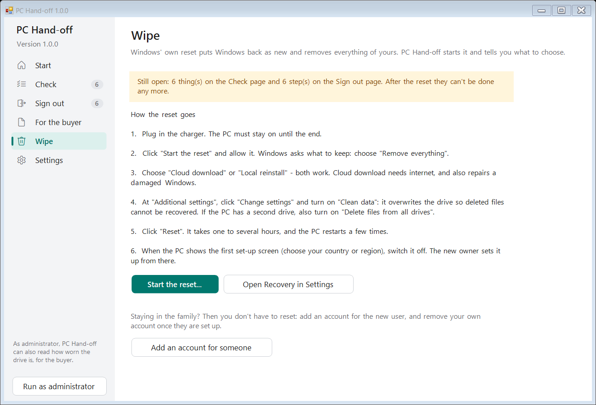

# PC Hand-off

Get your old Windows PC ready to sell, give away or recycle. PC Hand-off checks that nothing of yours is left behind, lists the accounts and licences still tied to the PC, writes the specs for the buyer, and walks you through Windows' own reset.

Free, open source, one small file, no account, nothing uploaded. Windows 10 and 11. In English, Dutch, German, French, Spanish, Italian and Polish.

**[Download PC-Handoff.exe](https://github.com/michaelkloprogge-gif/pc-handoff/releases/latest/download/PC-Handoff.exe)**

|  |  |
|---|---|

## The four steps

1. **Check** - what the reset would wipe that may not be anywhere else yet:
   - your Desktop, Documents, Pictures, Music, Videos and Downloads: in OneDrive, packed up with [PC Move](https://github.com/michaelkloprogge-gif/pc-move) (and how many files changed since), or only on this PC
   - Outlook mail files and Thunderbird mail kept on the PC
   - folders you made yourself on the Windows drive, a second drive, and other people's accounts
   - browser profiles that are not signed in, so their bookmarks and passwords are only on this PC
   - BitLocker (have your recovery key at hand) and the Windows licence (built into the PC, so the next owner keeps it?)
2. **Sign out** - programs that count this PC against a limit or stay linked to your accounts, found from what is installed: Microsoft 365, iTunes, iCloud, Adobe, Steam and other game launchers, Dropbox, Spotify, Netflix, Kindle, WhatsApp, Telegram, Signal, antivirus licences, password managers and music software. Each step opens the right page. Last of all: remove the PC from your Microsoft account.
3. **For the buyer** - the specs in plain words, ready to copy into an ad: model, processor, memory (and free slots), drive (and how worn it is, as administrator), graphics, screen, battery health, Windows and whether it can get Windows 11.
4. **Wipe** - starts Windows' own "Reset this PC" and tells you exactly what to choose: Remove everything, and Clean data so deleted files can't be recovered.

Tick things off as you go; the Start page shows how far you are.

## Good to know

- PC Hand-off **only reads**: nothing on the PC changes until you start the reset yourself.
- Moving to a new PC? Use [PC Move](https://github.com/michaelkloprogge-gif/pc-move) first. PC Hand-off finds its move folder on your USB drive and shows which files changed since.
- Windows may say *"Windows protected your PC"* the first time, because the app is not code-signed yet. Click **More info > Run anyway**.
- Staying in the family? You don't have to reset: add an account for the new user and remove yours once they are set up.

## Privacy

Nothing about your PC is sent anywhere. The only internet use is the update check (GitHub).

## Building

`.\build-exe.ps1` builds `dist\PC-Handoff.exe`: a small C# host with `pc-handoff.ps1` embedded, compiled with the C# compiler that ships with Windows - nothing to install. You can also run the script directly with `PC-Handoff.cmd`.

`.\build-msix.ps1` packs that exe as `dist\PC-Handoff.msix` for the Microsoft Store (needs the Windows SDK; the Store signs it). `-Register` installs the unpacked package on this PC to try it (Developer Mode). The Store copy leaves updates to the Store.

Tests: `.\tests\Test-Languages.ps1` (translation files) and `powershell -STA -File .\tests\Test-App.ps1 [-Language nl] [-Quick]` (looks at this PC for real and checks every page with test data, in a hidden window).

Release: bump `$AppVersion` in `pc-handoff.ps1`, then `.\publish-release.ps1 -Notes "..."`. GitHub Actions tests, builds and publishes it, and installed copies offer the update.

Made by the author of [PC Tune-Up](https://github.com/michaelkloprogge-gif/pc-tuneup) and [PC Move](https://github.com/michaelkloprogge-gif/pc-move). MIT licence.
